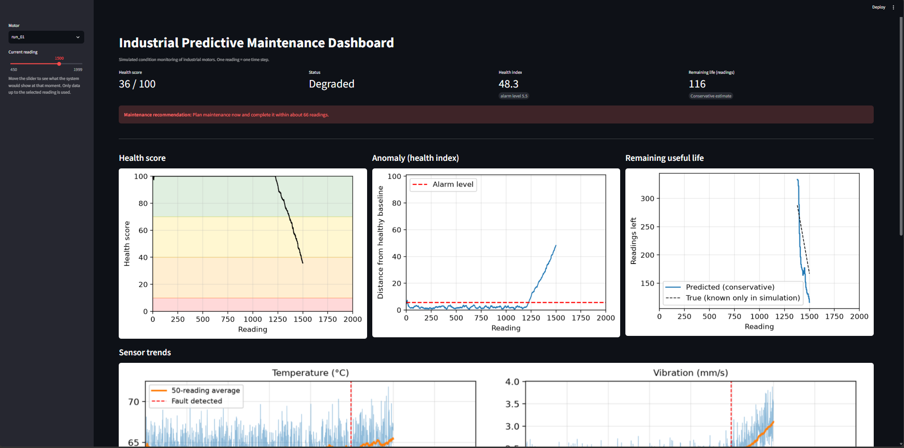
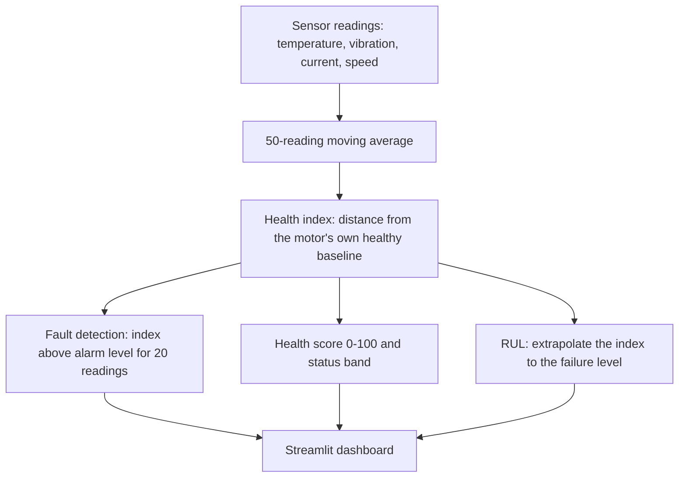
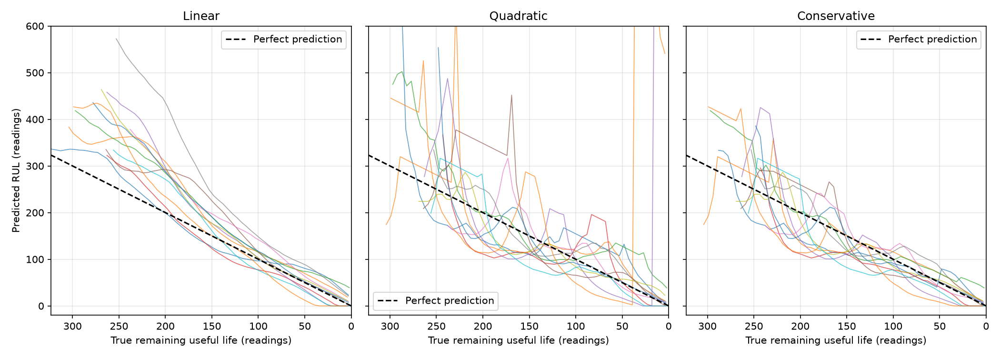

# Industrial Predictive Maintenance

Condition monitoring and remaining-useful-life (RUL) estimation for industrial motors, built and validated on simulated sensor data. The system learns what a healthy motor looks like, detects when it starts to degrade, converts that into a 0–100 health score, estimates how many readings are left before failure, and presents everything in a Streamlit dashboard.



## How it works



1. **Simulation** (`src/simulate.py`): 12 motors, 2000 readings each, with different degradation start points, durations and wear shapes (linear to accelerating), plus small motor-to-motor differences. During degradation vibration, current and temperature rise while speed falls.
2. **Health index** (`src/health.py`): the Mahalanobis distance between the smoothed sensor vector and the motor's own healthy baseline (its first 450 readings). It accounts for sensor scale and correlation, so one fixed alarm level works for every motor.
3. **Detection**: a fault is declared when the index stays above 5.5 for 20 consecutive readings.
4. **Health score**: 100 at the alarm level, falling linearly to 0 at the failure level. Bands: Healthy (>70), Warning (40–70), Degraded (10–40), Critical (<10).
5. **Remaining useful life** (`src/rul.py`): the last 150 readings of the index are fitted with a line and a parabola and extrapolated to the failure level. The reported "conservative" estimate is the earlier of the two. The failure level is learned from the *other* motors (leave-one-motor-out), so no motor is evaluated on its own data.
6. **Failure definition**: smoothed vibration reaching 3.5 mm/s (a placeholder, see Limitations).

## Results

12 simulated motors; all numbers are in readings.

**Fault detection.** Delay is the number of readings between the start of degradation and the first alarm. The first three rows use each motor's best-case threshold (zero false alarms); the last row is the fixed alarm level the pipeline actually uses.

| Detector | False alarms | Median delay | Worst delay | Degradation level at alarm |
|---|---|---|---|---|
| Vibration threshold | 0/12 | 100 | 141 | 0.09 |
| Isolation Forest | 0/12 | 92 | 117 | 0.08 |
| Health index (Mahalanobis) | 0/12 | 73.5 | 135 | 0.07 |
| Health index, fixed alarm level (deployed) | 0/12 | 125 | 151 | 0.12 |

The detectors perform similarly. The fixed alarm level costs about 50 readings of delay compared with a per-motor best case, in exchange for no false alarms and no per-motor tuning. Fault detection leaves roughly 340–420 readings before failure on these motors.

**RUL accuracy** (leave-one-motor-out):

| Estimator | MAE | MAE in last 200 readings before failure | Bias |
|---|---|---|---|
| Linear | 50.6 | 29.7 | +43.7 (too optimistic) |
| Quadratic | 59.0 | 53.7 | +22.4 |
| **Conservative (earlier of the two)** | **34.6** | **25.5** | **−4.2** |

Extrapolating smoothed vibration alone, even though failure is defined by vibration and the exact failure level is known, gives a conservative MAE of 41.3 (32.7 in the last 200 readings). The four-sensor health index is about 16–22% better.



Isolation Forest is a good detector here but not a basis for RUL: its anomaly score saturates once readings are far from the healthy range, so there is no trend to extrapolate. The Mahalanobis index keeps rising with the degradation.

## Run it

```powershell
python -m venv .venv
.venv\Scripts\Activate.ps1
pip install -r requirements.txt

python run_pipeline.py      # simulate, score, estimate RUL, save results to data/results/
python compare_models.py    # detector and RUL comparisons above
streamlit run dashboard.py  # interactive dashboard

pip install pytest
pytest                      # unit tests
```

On Linux or macOS, activate with `source .venv/bin/activate`.

The dashboard has a slider for the current reading, so it shows what the system would report at that moment using only data up to it: health score, status, health index against the alarm level, predicted remaining life, a maintenance recommendation, sensor trends and an alert history.

## Project structure

```
run_pipeline.py        end-to-end pipeline
compare_models.py      detector and RUL comparisons
dashboard.py           Streamlit dashboard
src/                   config, simulation, health index, RUL
tests/                 unit tests
experiments/           exploratory single-motor scripts that led to the design
figures/               plots used in this README
```

## Limitations

- **Simulated data.** All motors share the same sensor pattern and Gaussian noise. The simulator and the methods were developed together, so these results are optimistic compared with real machines.
- **The failure rule is a placeholder.** 3.5 mm/s smoothed vibration stands in for a real limit, which should come from a vibration severity standard (for example ISO 20816) or the manufacturer.
- **Rules of thumb.** The score bands (70/40/10) and the 50-reading safety margin in the maintenance recommendation are not tuned values.
- **Small sample.** 12 motors, so differences between methods of a few percent are not statistically meaningful.
- **Assumptions.** Each motor's first 450 readings are assumed healthy, and a reading is a time step, not a calibrated unit of time.

## Next steps

- Validate on real run-to-failure data (for example the NASA/IMS bearing dataset or C-MAPSS).
- Report RUL with an uncertainty band instead of a single number.
- Show which sensor contributes most to the health index.
- Add other failure modes and update the baseline online.

## Author

· GitHub: ossamabarko-eng · LinkedIn: Ossama Barko